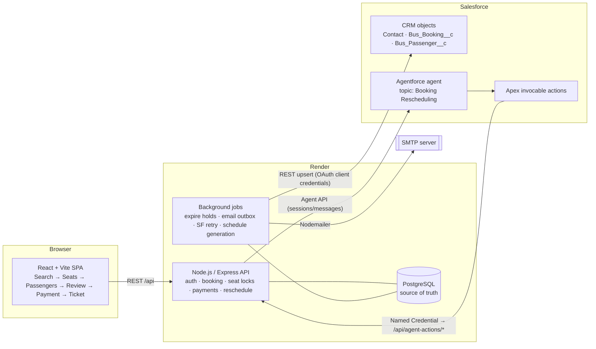
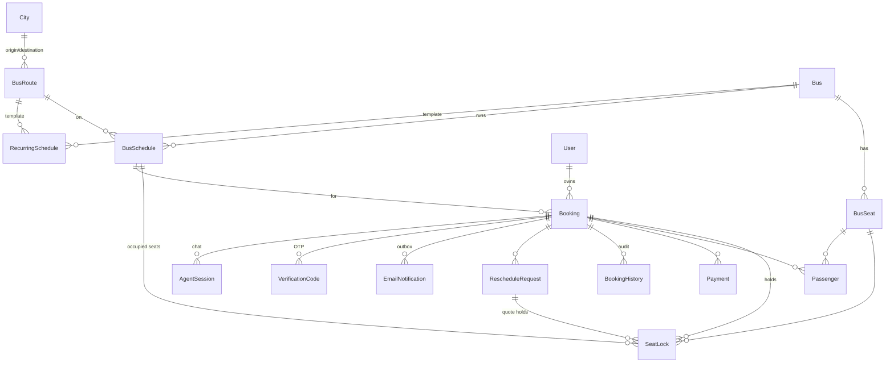
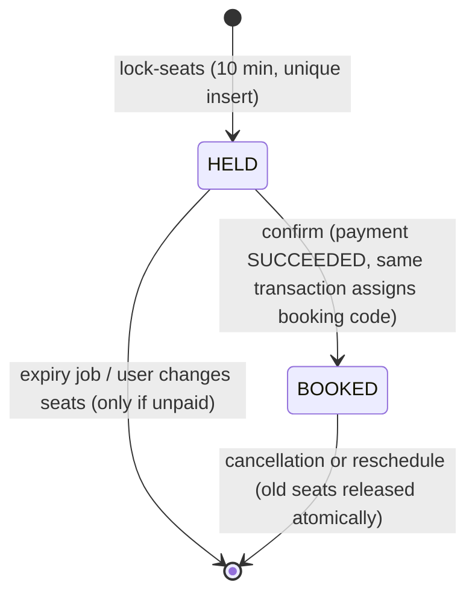
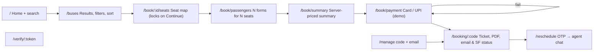
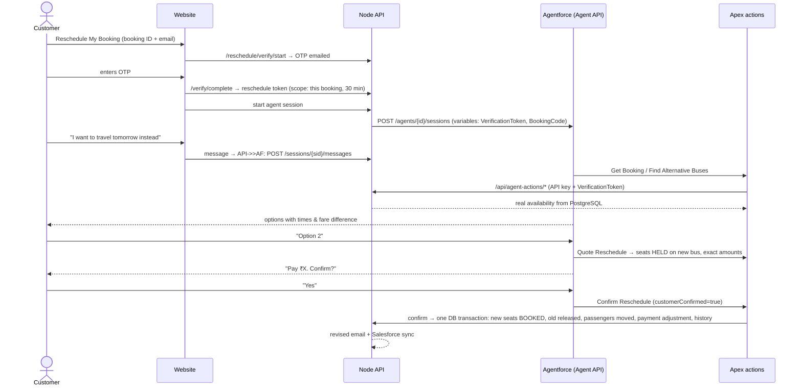

# BusYatra — Architecture

## 1. System overview



**Design rule:** PostgreSQL owns seat inventory, bookings and payments. Salesforce is a CRM mirror and the conversational layer. The AI agent can only *call* backend actions; every business rule (availability, locking, fares, policy, confirmation) is enforced in Node.

## 2. Backend layout

```
backend/
  prisma/schema.prisma, migrations/, seed.js
  src/
    server.js, app.js              bootstrap, middleware, graceful shutdown
    config/env.js                  all configuration from env vars
    routes/index.js                REST routes + zod validation
    controllers/*                  HTTP <-> service mapping
    middleware/                    auth (JWT, roles, reschedule token, agent API key), validate, errors
    services/
      busService                   search, filters, sort, seat map
      inventory                    shared "occupied seat" / "reclaimable hold" predicates
      bookingService               lock seats, passengers, confirm, cancel
      pricing                      fare + GST + fees (integer paise)
      payment/                     paymentService + providers/ (demo simulator; pluggable)
      email/                       outbox queue, templates, Nodemailer transport
      ticket/pdfService            PDFKit e-ticket with QR
      salesforce/                  OAuth client + idempotent upsert sync with retry
      reschedule/                  OTP ownership verification + reschedule engine
      agent/                       Agentforce Agent API provider, labelled mock provider, date parser
      adminService, scheduleService
    jobs/scheduler.js              interval jobs (all idempotent)
  tests/e2e.test.js               15 scenario end-to-end suite
```

## 3. Database schema (PostgreSQL / Prisma)



Key constraints:

| Constraint | Purpose |
| --- | --- |
| `SeatLock UNIQUE(scheduleId, seatId)` | **The** double-booking guarantee. Two concurrent inserts for one seat → exactly one succeeds. |
| `Payment_one_success_per_booking` (partial unique index, `status='SUCCEEDED' AND kind='BOOKING'`) | A booking can never be paid twice. |
| `Payment.idempotencyKey UNIQUE` | Client retries of "create payment" return the same intent. |
| `Booking.bookingCode UNIQUE` + `DailyCounter` (`INSERT … ON CONFLICT … RETURNING`) | Race-free sequential IDs like `BUS202611030001`. |
| `BusSchedule UNIQUE(busId, departureAt)` | A bus can't be scheduled twice at the same time. |
| `Passenger UNIQUE(bookingId, seatId)` | One passenger per seat. |

Money is stored as integer **paise**. Times are UTC in the DB; the business operates in IST (UTC+05:30) and date searches use IST day boundaries.

### Seat lifecycle



A HELD lock whose booking has a successful payment is never reclaimed, even past expiry — a recovery job confirms such bookings if the client disappears after paying.

## 4. API

All responses: `{ success: true, data }` or `{ success: false, error: { code, message, details? } }` with proper HTTP status codes (400 validation, 401/403 auth, 404, 409 conflicts such as `SEATS_UNAVAILABLE` / `ALREADY_PAID`, 410 `HOLD_EXPIRED`).

| Method & path | Auth | Purpose |
| --- | --- | --- |
| `GET /api/health` | – | Status + which integrations are configured |
| `POST /api/auth/register`, `/login`, `GET /me` | – / JWT | Accounts |
| `GET /api/cities` | – | City list |
| `GET /api/buses/search?from&to&date&acType&seatClass&departure&operators&minPrice&maxPrice&sort&page&pageSize` | – | Search with filters, sort, pagination, facets |
| `GET /api/buses/:scheduleId` | – | Trip details |
| `GET /api/buses/:scheduleId/seats` | – | Live seat map |
| `POST /api/bookings/lock-seats` | optional JWT | Hold seats → returns booking id + `accessToken` |
| `DELETE /api/bookings/:id/hold` | access token | Release hold |
| `POST /api/bookings/passengers` | access token | One passenger per held seat + contact |
| `POST /api/payments/create` | access token, `Idempotency-Key` | Payment intent |
| `POST /api/payments/verify` | access token | Process (demo) + verify server-side |
| `POST /api/payments/upi/verify`, `GET /api/payments/test-instruments` | – | Demo helpers |
| `POST /api/bookings/confirm` | access token | Confirm (requires SUCCEEDED payment); idempotent |
| `GET /api/bookings/:idOrCode` | token / owner / admin / `?email=` | Booking details + history |
| `GET /api/bookings/:idOrCode/ticket.pdf` | same | PDF e-ticket |
| `GET /api/bookings/mine` | JWT | My trips |
| `GET /api/tickets/verify/:ticketToken` | – | QR target, minimal info |
| `POST /api/reschedule/verify/start`, `/complete` | – (rate limited) | Email OTP → 30-min reschedule token |
| `GET /api/bookings/:id/reschedule/alternatives?date` | reschedule token | Alternatives |
| `POST /api/bookings/:id/reschedule` | reschedule token | Quote (holds new seats) |
| `POST /api/bookings/:id/reschedule/:requestId/confirm` | reschedule token, `customerConfirmed: true` | Apply |
| `POST /api/reschedule/agent/sessions`, `…/:sid/messages`, `DELETE …/:sid` | reschedule token | Chat with Agentforce / mock |
| `POST /api/agent-actions/{get-booking,find-alternatives,quote,confirm}` | `x-agent-api-key` + customer `verificationToken` | Called by Salesforce Apex |
| `/api/admin/*` (stats, bookings, cancel, resync, buses, layouts, routes, schedules) | JWT role ADMIN | Admin dashboard |

## 5. Frontend page flow



State between stages lives in `BookingContext` (sessionStorage-backed); every stage re-reads from the API so the server stays authoritative. Framer Motion `AnimatePresence` animates route transitions, the stepper, seat selection and the chat.

## 6. Salesforce integration

```mermaid
sequenceDiagram
  participant API as Node API
  participant DB as PostgreSQL
  participant SF as Salesforce REST
  API->>DB: confirm booking (tx) — sfSyncStatus=PENDING
  API-->>API: kickSalesforceSync (async)
  API->>SF: POST /services/oauth2/token (client_credentials)
  API->>SF: PATCH Contact/BusApp_Customer_Key__c/{email}
  API->>SF: PATCH Bus_Booking__c/Booking_ID__c/{code} (Customer__r by ext id)
  API->>SF: PATCH Bus_Passenger__c/Passenger_Key__c/{id} (Booking__r by ext id)
  alt success
    API->>DB: sfSyncStatus=SYNCED
  else error / Salesforce down
    API->>DB: sfSyncStatus=FAILED, sfLastError, sfNextAttemptAt (exponential backoff)
    Note over API,DB: retry job every 2 min, up to 8 attempts; admin "Retry sync" button
  end
```

Upserts keyed on external IDs make retries idempotent. Sync is triggered on confirm, reschedule and cancellation. See [SALESFORCE_SETUP.md](SALESFORCE_SETUP.md).

## 7. Agentforce rescheduling



Guard rails enforced **in the backend**, not just in prompts: verification token scoped to one booking; cancelled/expired bookings rejected; cutoff (6 h), max reschedules (2), same route only; new seats go through the same unique-lock mechanism; `customerConfirmed` must be literally `true`; a quote expires after 10 minutes.

Without `AGENTFORCE_CONFIGURATION`, a deterministic **mock agent** (labelled "Mock agent … not connected to Salesforce Agentforce" in API and UI) drives the same backend actions. See [AGENTFORCE_SETUP.md](AGENTFORCE_SETUP.md).
